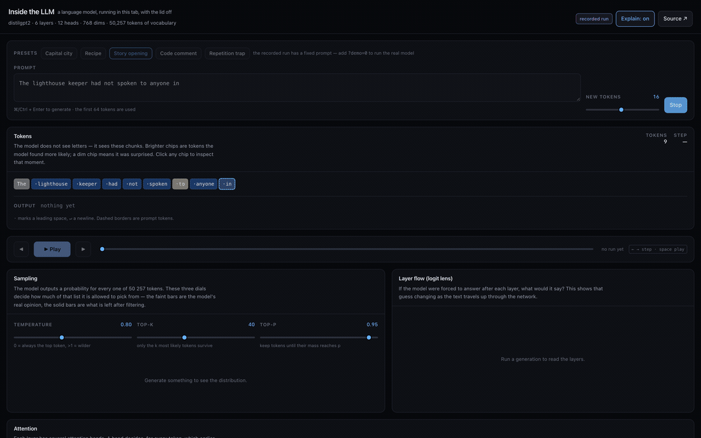
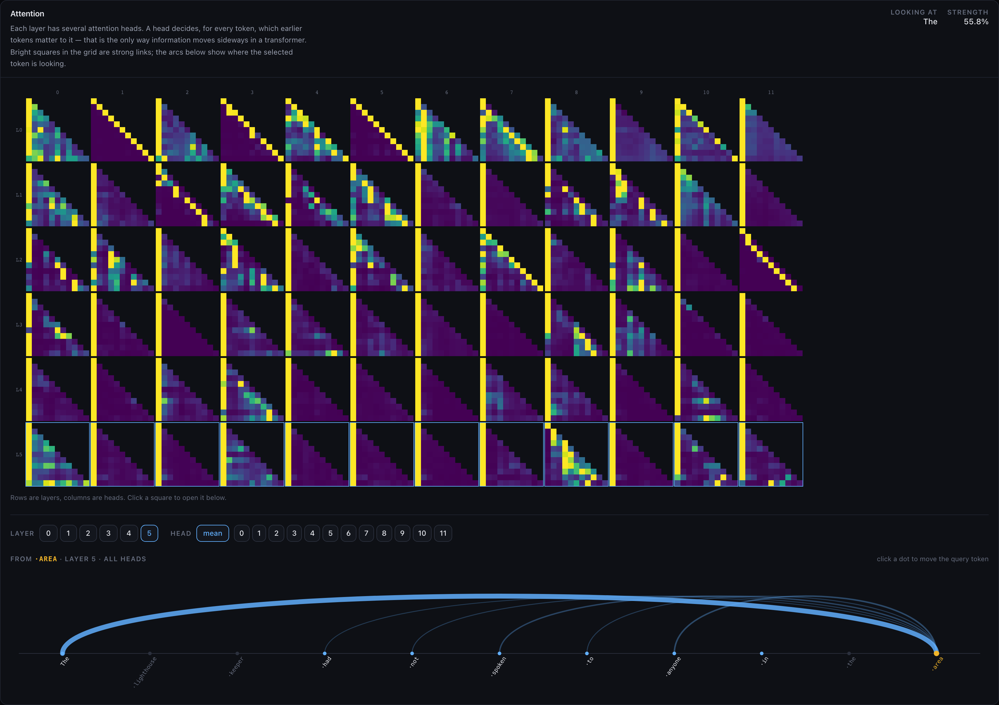
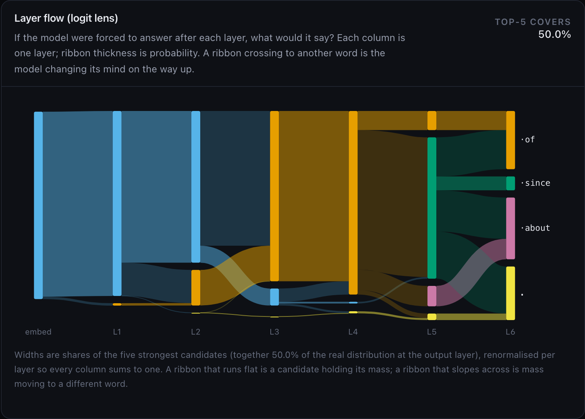
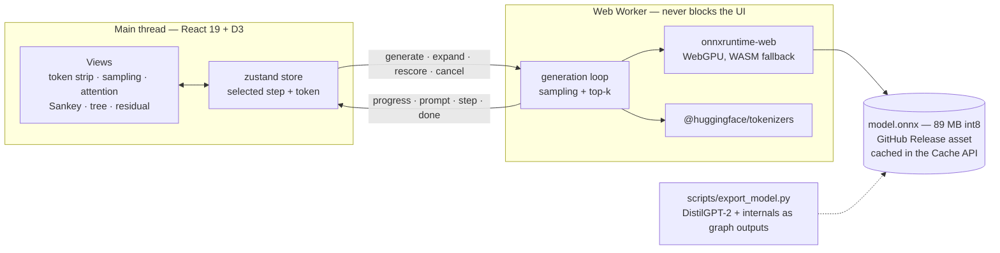

<div align="center">

# Inside the LLM

**A language model runs in your browser tab. This shows you what it is doing while it writes.**

[**Live demo**](https://jaworskig00.github.io/inside-the-llm/) ·
[Recorded run, nothing to download](https://jaworskig00.github.io/inside-the-llm/?demo=1) ·
[Decisions log](DECISIONS.md)

[](https://github.com/jaworskig00/inside-the-llm/actions/workflows/ci.yml)
[](https://github.com/jaworskig00/inside-the-llm/actions/workflows/deploy.yml)
[](LICENSE)



</div>

---

DistilGPT-2 — a real 82 M-parameter transformer — is downloaded once, started in a Web
Worker and run entirely on your machine. No server, no API key, nothing leaves the tab.
Then every internal quantity the model produces while writing the next word is put on
screen: which earlier words each attention head is reading, what the model would have said
if it had stopped at layer 3, which words it nearly picked instead, and exactly what the
temperature slider does to its opinion.

The interesting part is not that a model runs client-side. It is that the
internals needed to visualise it **are not in any published ONNX checkpoint** — they are
thrown away at export time. Getting them out was the hard part of this project, and
[`scripts/export_model.py`](scripts/export_model.py) is where it happens.

---

## What you are looking at

| View                        | What it shows                                                                                                                                                                                                                                                                                |
| --------------------------- | -------------------------------------------------------------------------------------------------------------------------------------------------------------------------------------------------------------------------------------------------------------------------------------------- |
| **Tokens**                  | The prompt and the generated text as the chunks the model actually sees. Colour is the probability the model gave that token given everything before it — for the prompt that is teacher forcing, so a dim chip is text the model found surprising. Clicking a chip drives every other view. |
| **Sampling**                | The next-token distribution over all 50 257 tokens. The faint bar is the model's own opinion; the solid bar is what survives temperature, top-k and top-p. Moving a slider re-filters the real logits — no re-run, no approximation.                                                         |
| **Attention**               | Every head in the model at once: 6 layers × 12 heads of causal attention matrices. Previous-token heads show as a bright diagonal, attention sinks as a bright first column. Click any head to open it in the arc diagram below, which draws where the selected token is looking.            |
| **Layer flow (logit lens)** | What the model would say if it were forced to answer after each layer. Columns are layers, ribbon width is probability, and a ribbon sloping across to another word is the model changing its mind on the way up the stack.                                                                  |
| **Alternatives**            | The roads not taken. Each node expands into the five most likely continuations _from that point_ — one real forward pass per click, computed lazily. Shift-click re-runs the whole generation from that branch.                                                                              |
| **Residual stream**         | The magnitude of each token's 768-number state at each layer. Logarithmic, because the output layer's norms are two orders of magnitude above the embedding's.                                                                                                                               |

Every view is linked to one selected step and one selected token, so stepping through the
run (`←` `→`, space to play) animates all of them together. **Explain mode** puts a
plain-language sentence on each panel; it is on by default and toggles in the header.

|                                                                  |                                                 |
| ---------------------------------------------------------------- | ----------------------------------------------- |
|  |  |

---

## Architecture



One forward pass per generated token returns six tensors:

```
logits          (1, V)            next-token logits          → sampling, bar chart
attentions      (1, L, H, T, T)   post-softmax weights       → head grid, arc diagram
hidden_norms    (1, L+1, T)       residual-stream L2 norms   → residual strip
token_logprobs  (1, T)            log p(token | prefix)      → token colours
lens_values     (1, L+1, K)       logit-lens top-k log-probs → Sankey
lens_indices    (1, L+1, K)       logit-lens top-k ids       → Sankey
```

The worker turns those into one `StepRecord` and posts it to the main thread, transferring
the attention buffer rather than cloning it. Everything that crosses the boundary is
declared once in [`src/lib/protocol.ts`](src/lib/protocol.ts).

---

## Technical highlights

**Getting the internals out of the model.** Published ONNX checkpoints expose `logits` and
a KV cache — the attention weights and hidden states have no output node, so no runtime
flag can retrieve them. `scripts/export_model.py` wraps DistilGPT-2 with
`attn_implementation="eager"` (PyTorch's fused SDPA kernel never materialises attention
weights) and exports the internals as first-class outputs. The top-k reduction for the
logit lens happens **inside the graph**: raw, it is `(L+1) × 50257` floats per step; reduced
to `K=10` it is 70 numbers, so the worker sends the UI something it can plot instead of
1.4 MB to sort on the main thread.

**No KV cache, on purpose.** Re-reading the whole sequence every step is quadratic, and for
the lengths this demo allows it costs a few milliseconds. What it buys is the full `T × T`
attention matrix at every step. A cached export only ever returns the last attention _row_,
which is not enough to draw any of this.

**Quantisation that accounts for tied weights.** DistilGPT-2 is 82 M parameters, 38.6 M of
them the token embedding that the LM head reuses. Quantising only `MatMul` leaves that
embedding in fp32 and the download stays above 150 MB; including `Gather` brings the whole
model to **89 MB**.

**Canvas where it matters, SVG where it helps.** The head grid repaints 6 × 12 × T² cells —
294 912 of them at a 64-token context. As SVG rects that is a third of a million DOM nodes
and the tab dies; on canvas it is 72 `drawImage` calls, around 3 ms, with viridis baked into
a 256-entry byte LUT so the inner loop is three array reads instead of an allocation. The
arc diagram is SVG, because after thresholding it is a couple of dozen paths that need hit
testing, tooltips and tweened `d` attributes.

**A Sankey that conserves mass.** The logit lens gives a distribution per layer, not a flow,
so the diagram is built as a transport plan: each candidate keeps `min(p_layer, p_next)` of
its own mass and sheds the rest, and the shed mass is matched to the candidates that gained
by the north-west corner rule. That produces at most `|surplus| + |deficit| - 1` ribbons
instead of the full product — the difference between a readable diagram and a barcode — and
mass conservation is asserted in the unit tests.

**Measured on an Apple M4 Pro (12 cores) in Chromium 152, against the deployed site**,
prompt + 16 tokens:

|                                                | start-up, weights cached            | throughput   |
| ---------------------------------------------- | ----------------------------------- | ------------ |
| WebGPU                                         | 0.8 – 2.7 s                         | 5 – 17 tok/s |
| WASM, 4 threads                                | 1.5 s                               | 4 – 5 tok/s  |
| WASM, 1 thread (before cross-origin isolation) | **never finished inside 2 minutes** | —            |

Two honest caveats about that table. First, the throughput range is wide because it is: the
same tab measured 17 tok/s on a fresh load and 5 tok/s twenty minutes and a dozen runs
later, with no code change in between. A single headline number would be fiction, which is
why the app shows live tok/s and per-pass milliseconds — the number that matters is the one
on your machine. Second, the last row is not a slow path, it is a broken one, and fixing it
is what [`public/coi-sw.js`](public/coi-sw.js) is for.

**Cross-origin isolation on a host that cannot send headers.** onnxruntime-web needs
`SharedArrayBuffer` for multi-threaded WASM, which needs COOP/COEP response headers, which
GitHub Pages does not send. Single-threaded, building the inference session never completed
— so every visitor without WebGPU got a progress bar that would not move. A service worker
re-serves each response with the isolation headers and the page reloads once to pick them
up; session creation drops to 1.5 s. `require-corp` rather than `credentialless`, because
every asset here is same-origin, so there is nothing to relax and `require-corp` is the
variant Safari supports.

**Bundle, after keeping ORT out of it.** onnxruntime-web ships ~55 MB of prebuilt WASM
variants, and a bundler that follows its `new URL(..., import.meta.url)` calls emits every
one of them. Loading the prebuilt ESM bundle from our own `public/ort/` at runtime instead
leaves: app `275 kB` (87 kB gzipped), d3 `75 kB` (27 kB), worker `44 kB`, CSS `21 kB`
(5 kB). The runtime itself is fetched on demand and sized to the machine — 27 MB for the
WebGPU build, 14 MB for the plain WASM one, so a machine with no GPU adapter does not
download the GPU runtime.

**Everyone gets to see it work.** `?demo=1` replays
[`public/demo-run.json`](public/demo-run.json), a run recorded from the real ONNX graph by
[`scripts/record_fixture.mjs`](scripts/record_fixture.mjs), through the same worker
protocol. It is what a phone gets, what someone on a metered connection gets, and what CI
uses — so the end-to-end suite exercises every view without downloading 89 MB.

---

## Running it locally

```bash
git clone https://github.com/jaworskig00/inside-the-llm
cd inside-the-llm
npm install
npm run dev           # http://localhost:5173/inside-the-llm/
```

Without weights the app still runs in full on the recorded run — open `?demo=1`. To run the
real model locally, either let it fetch the published release asset, or export your own:

```bash
python -m venv .venv && source .venv/bin/activate
pip install torch transformers onnx onnxruntime onnxscript
python scripts/export_model.py --out .devmodel     # ~3 min, writes model.onnx (89 MB)
```

`.devmodel/model.onnx` is served at `/model/model.onnx` by a dev-only middleware in
[`vite.config.ts`](vite.config.ts), so nothing large is ever copied into `dist/`.

| Command                              |                                                                                    |
| ------------------------------------ | ---------------------------------------------------------------------------------- |
| `npm run dev`                        | dev server, with COOP/COEP so WASM can use threads                                 |
| `npm run build`                      | typecheck + production build into `dist/`                                          |
| `npm test`                           | unit tests — sampling maths, attention indexing, Sankey conservation, tree reducer |
| `npm run e2e`                        | Playwright, against the recorded run                                               |
| `npm run lint` / `npm run typecheck` | ESLint, TypeScript                                                                 |
| `npm run record:fixture`             | re-record `public/demo-run.json` from the real graph                               |
| `npm run shots`                      | regenerate the README media with Playwright + ffmpeg                               |

### Useful URL switches

|                       |                                                         |
| --------------------- | ------------------------------------------------------- |
| `?demo=1` / `?demo=0` | force the recorded run on or off (phones default to on) |
| `?backend=wasm`       | pin the CPU path, to see the fallback on purpose        |

---

## Hosting

**The weights.** `model.onnx` is published as a GitHub Release asset rather than committed —
an 89 MB binary has no business in git history — and the deploy workflow pulls it into
`dist/model/` before publishing, so the browser fetches it **from the app's own origin**.

That last part is not cosmetic. GitHub serves release assets with no
`access-control-allow-origin` header, so fetching one directly from a page on
`github.io` is blocked by CORS. Same-origin side-steps the question entirely, the blob
still stays out of git history, and the release remains the canonical copy.

```bash
./scripts/publish_model.sh model-v1 .devmodel/model.onnx
```

To host it anywhere else — a Hugging Face repo, an R2 bucket, your own server — set
`VITE_MODEL_URL` at build time. The only requirement is that the host sends CORS headers,
which is exactly what GitHub Releases do not.

**The app.** [`deploy.yml`](.github/workflows/deploy.yml) builds with
`VITE_BASE=/<repo>/` and pushes `dist/` to GitHub Pages, then fetches the published URL and
fails the run if it does not come back with the app. Pages itself has to be switched on
once before the first deploy — the default `GITHUB_TOKEN` is not allowed to create the
site:

```bash
gh api -X POST repos/OWNER/REPO/pages -f build_type=workflow
```

To move to Cloudflare Pages, Netlify or
a server of your own: build with `VITE_BASE=/`, publish `dist/`, and keep
[`public/_headers`](public/_headers) — those hosts honour it, and cross-origin isolation
turns the WASM path into the fast one.

---

## Known limitations

- **DistilGPT-2 is a small, old model.** Six layers, 2019 training data. It repeats itself,
  it drifts, and it will confidently tell you the capital of France is the capital of
  France. That is the point — the mechanics are the subject here, not the output quality.
- **No KV cache**, so the context is capped at 64 prompt tokens and 32 generated ones.
  Beyond that the quadratic re-read stops being free.
- **Throughput is not stable.** It varies by about 3x on the same machine depending on how
  much the browser and GPU have already been asked to do. The live readout is the number to
  trust, not the table.
- **Cross-origin isolation depends on a service worker** on GitHub Pages. If it fails to
  register — a browser that blocks service workers, a non-secure context — the app still
  works, single-threaded, and a browser without WebGPU is offered the recorded run rather
  than a progress bar that never moves.
- **int8 quantisation** shifts probabilities slightly against the fp32 model. Attention rows
  still sum to 1 to within 1e-2, which the export script asserts.
- **Single-token decoding** can show replacement characters for tokens that are a partial
  UTF-8 sequence. The strip shows the real vocabulary entries, byte-level artefacts and all.

---

## Author

**Grzegorz Jaworski** — [gj-dev.com](https://gj-dev.com) ·
[github.com/jaworskig00](https://github.com/jaworskig00) ·
[linkedin.com/in/jaworskig00](https://linkedin.com/in/jaworskig00)

MIT licensed. DistilGPT-2 is Apache-2.0, from Hugging Face.
